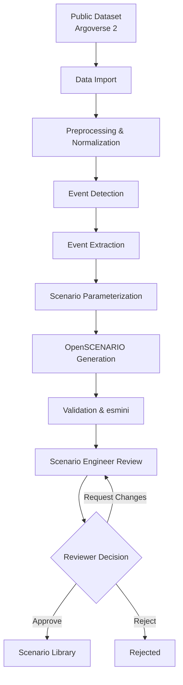
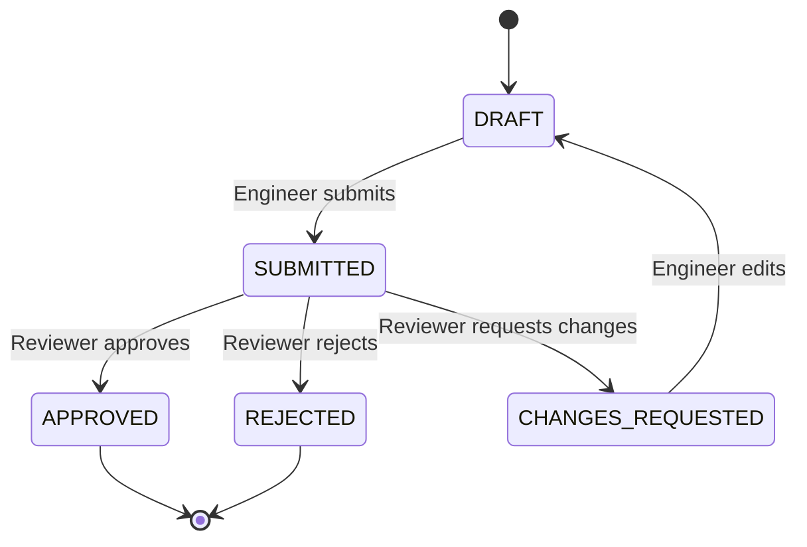
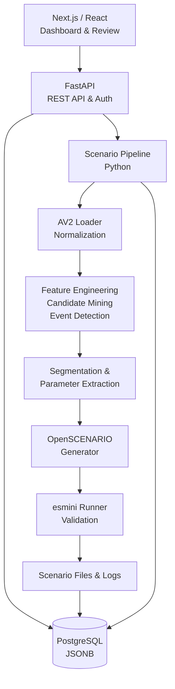
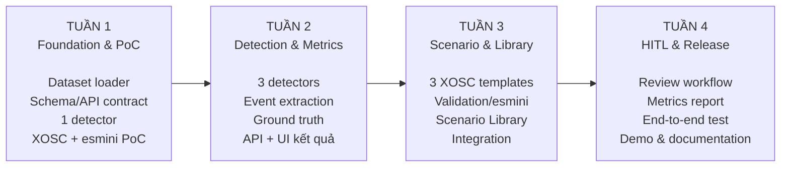
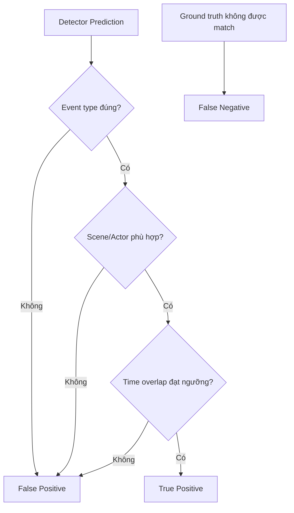
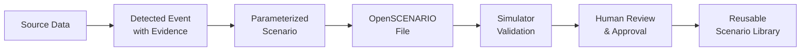

# ADAS-24 ScenarioMiner
## Product Requirements Document (PRD)

| Thuộc tính | Nội dung                                                                     |
|---|------------------------------------------------------------------------------|
| Phiên bản | 1.0                                                                          |
| Trạng thái | Draft for team review                                                        |
| Thời gian triển khai | **4 tuần**                                                                   |
| Quy mô nhóm | 4 thành viên                                                                 |
| Phương pháp | Agile / Kanban tinh gọn                                                      |
| Sản phẩm | ScenarioMiner – Real-world Driving Scenario Mining & OpenSCENARIO Generation |

## 1. Tổng quan

### 1.1. Bối cảnh và vấn đề

Dữ liệu lái xe thực chứa nhiều tình huống có giá trị kiểm thử ADAS và xe tự hành, chẳng hạn như xe chuyển làn cắt ngang (Cut-in), phanh gấp (Hard Braking) và người đi bộ băng qua đường (Pedestrian Crossing).

Tuy nhiên, log lái xe thường khó tái sử dụng trực tiếp. Kỹ sư phải tìm đoạn dữ liệu phù hợp, xác định các đối tượng và thời điểm liên quan, tính toán tham số rồi chuyển đổi thành kịch bản mô phỏng.

### 1.2. Giải pháp

**ScenarioMiner** là ứng dụng web hỗ trợ tự động khai thác tình huống giao thông từ dữ liệu lái xe, chuyển đổi chúng thành scenario có cấu trúc và sinh tệp ASAM OpenSCENARIO (`.xosc`) để kiểm tra bằng esmini.

Kỹ sư có thể xem, chỉnh sửa, gắn tag và gửi scenario cho reviewer phê duyệt trước khi đưa vào thư viện dùng chung.

### 1.3. Giá trị cốt lõi

- Giảm thời gian tìm kiếm và mô tả tình huống từ dữ liệu thô.
- Tự động trích xuất sự kiện và tham số chuyển động.
- Chuyển dữ liệu thực thành kịch bản mô phỏng có cấu trúc.
- Quản lý, tìm kiếm và tái sử dụng scenario tập trung.
- Có Human-in-the-Loop (HITL) để kiểm soát chất lượng.

### 1.4. Phạm vi và giới hạn

Sản phẩm là công cụ hỗ trợ tạo và quản lý kịch bản kiểm thử trong môi trường mô phỏng. Không điều khiển xe thật, không thay thế hệ thống ADAS và không khẳng định subset dữ liệu được chọn phản ánh tần suất sự kiện ngoài đời thực.

## 2. Mục tiêu MVP và tiêu chí thành công

Trong 4 tuần, nhóm cần hoàn thành một luồng demo đầu-cuối:

1. Đọc được một subset của **Argoverse 2 Motion Forecasting**.
2. Chuẩn hóa dữ liệu trajectory về schema nội bộ.
3. Phát hiện ba loại sự kiện: Cut-in, Hard Braking và Pedestrian Crossing.
4. Trích xuất khoảng thời gian, actor và các tham số quan trọng.
5. Sinh file OpenSCENARIO `.xosc` cho cả ba loại sự kiện.
6. Kiểm tra XML và chạy thử scenario bằng esmini trong phạm vi hỗ trợ.
7. Có Scenario Library với tìm kiếm, tag và bộ lọc cơ bản.
8. Có hai vai trò Engineer / Reviewer và quy trình HITL.
9. Có bộ nhãn tay và báo cáo Precision / Recall theo từng loại sự kiện.
10. Có tài liệu cài đặt và kịch bản demo.

### 2.1. Chỉ số nghiệm thu

| Chỉ số | Cách đánh giá |
|---|---|
| Event Precision | TP / (TP + FP), báo cáo theo từng loại |
| Event Recall | TP / (TP + FN), báo cáo theo từng loại |
| OpenSCENARIO validity | Số file `.xosc` chạy được / tổng số file đã thử |
| Traceability | 100% scenario lưu trong thư viện có liên kết về scene/event nguồn |
| HITL workflow | Demo được Submit → Review → Approve/Reject/Request Changes |
| Library usability | Tìm kiếm và lọc được theo event type, tag, trạng thái |

Không đặt trước ngưỡng Precision/Recall hoặc tỷ lệ chạy thành công khi chưa có baseline. Báo cáo phải nêu số lượng mẫu, cách chọn mẫu và giới hạn dữ liệu.

## 3. Phạm vi chức năng

### 3.1. Bắt buộc – P0

- Import subset Argoverse 2 Motion Forecasting.
- Chuẩn hóa timestamp, tọa độ, đơn vị, track ID và trajectory.
- Phát hiện Cut-in, Hard Braking, Pedestrian Crossing.
- Event extraction và parameter extraction.
- Tạo scenario record có cấu trúc.
- Sinh và kiểm tra OpenSCENARIO `.xosc`.
- Chạy thử bằng esmini và lưu trạng thái/log.
- Scenario Library: tag, filter, search và xem chi tiết.
- HITL workflow với Engineer và Reviewer.
- Báo cáo Precision/Recall dựa trên nhãn tay.
- Demo đầu-cuối.

### 3.2. Có thể làm nếu còn thời gian

- Hiển thị trajectory 2D và timeline sự kiện.
- Chỉnh sửa tham số trực tiếp trên giao diện.
- Lưu phiên bản scenario và lịch sử review.
- AI Explanation: LLM tạo mô tả dễ hiểu từ dữ liệu đã trích xuất.
- Feedback Learning: thu thập phản hồi reviewer để cải thiện rule/threshold hoặc dữ liệu huấn luyện.

### 3.3. Ngoài phạm vi 4 tuần

- Huấn luyện deep learning model phức tạp.
- Dự đoán trajectory.
- Xây dựng engine mô phỏng 3D riêng.
- Hỗ trợ toàn bộ tính năng của OpenSCENARIO.
- Vector database, AI agent hoặc hệ thống multi-agent.
- Parameter sweep quy mô lớn, HDBSCAN clustering và uncertainty calibration.
- Triển khai production-scale hoặc hệ thống IAM doanh nghiệp.

## 4. Người dùng và nghiệp vụ

### 4.1. Vai trò

| Vai trò | Trách nhiệm |
|---|---|
| Scenario Engineer | Xem event, chỉnh sửa tham số/tag, sinh `.xosc`, gửi duyệt |
| Reviewer | Kiểm tra dữ liệu nguồn và scenario; Approve, Reject hoặc Request Changes |

MVP sử dụng tài khoản demo với hai role. Backend phải kiểm tra quyền reviewer; không chỉ ẩn nút trên frontend.

### 4.2. Luồng nghiệp vụ tổng thể



### 4.3. Trạng thái scenario



Mỗi quyết định review cần lưu người thao tác, thời điểm và nhận xét. Reject/Request Changes phải có comment. Chỉ scenario Approved mới thuộc thư viện chính thức.

## 5. Core AI Pipeline

Pipeline được chia thành 10 bước, từ xử lý trajectory đến tạo scenario và tiếp nhận phản hồi.

| Bước | Công nghệ / phương pháp | Vai trò |
|---|---|---|
| 1. Data Processing | NumPy, Pandas | Chuẩn hóa dữ liệu trajectory |
| 2. Feature Engineering | Feature extraction | Tạo đặc trưng chuyển động và tương tác |
| 3. Candidate Mining | Rules, Isolation Forest | Sàng lọc các đoạn bất thường |
| 4. Event Detection | Rule-based, Random Forest, XGBoost | Nhận diện tình huống |
| 5. Event Segmentation | Temporal analysis | Xác định thời điểm bắt đầu/kết thúc |
| 6. Parameter Extraction | Mathematical algorithms | Tính tốc độ, gia tốc, TTC, khoảng cách |
| 7. Event Scoring | Feature scoring | Xếp hạng mức độ đáng chú ý |
| 8. AI Explanation | LLM | Giải thích tình huống bằng ngôn ngữ tự nhiên |
| 9. Scenario Generation | OpenSCENARIO templates | Sinh kịch bản mô phỏng |
| 10. Feedback Learning | Human-in-the-Loop, Active Learning | Thu thập phản hồi để cải thiện model |

### 5.1. Nguyên tắc triển khai pipeline trong 4 tuần

- Ưu tiên NumPy/Pandas và rule-based detection để sớm có kết quả kiểm chứng được.
- Random Forest, XGBoost và Isolation Forest chỉ đưa vào khi có dữ liệu/nhãn và chứng minh được lợi ích; không bắt buộc phải dùng đồng thời.
- Event Scoring dùng các đặc trưng và ngưỡng có thể giải thích.
- LLM chỉ diễn giải dữ liệu đã được trích xuất; không được tự quyết định tham số vật lý hoặc tính hợp lệ của scenario.
- OpenSCENARIO Generator phải dựa trên scenario record và template có kiểm soát.
- Feedback Learning trong MVP tập trung thu thập quyết định/nhận xét của reviewer và lưu dữ liệu phản hồi. Không đặt mục tiêu huấn luyện lại model tự động trong 4 tuần.

### 5.2. Ba loại sự kiện cần phát hiện

| Event | Logic MVP | Tham số chính |
|---|---|---|
| Cut-in | Actor từ vùng/lane lân cận dịch chuyển vào vùng di chuyển của ego | Ego/target speed, khoảng cách dọc/ngang, lateral displacement, lane-change duration, minimum distance |
| Hard Braking | Actor giảm tốc mạnh trong khoảng thời gian ngắn | Speed before/after, longitudinal acceleration, deceleration duration |
| Pedestrian Crossing | Pedestrian di chuyển cắt qua hướng/quỹ đạo của ego | Ego/pedestrian speed, initial distance, crossing duration, minimum distance, time to closest approach |

Các ngưỡng detector phải cấu hình được và lưu cùng kết quả. Nếu thiếu lane hoặc ego track, cần nêu rõ phương pháp thay thế và giới hạn.

## 6. Dữ liệu và mô hình scenario

### 6.1. Dataset

Dataset chính: **Argoverse 2 Motion Forecasting**. Chỉ xử lý subset phù hợp với phần cứng và thời gian dự án.

Trước khi sử dụng, nhóm phải xác minh:

- Schema và các trường trajectory/actor thực tế.
- Khả năng xác định ego và actor type.
- Số lượng pedestrian track trong subset.
- Dung lượng, thời gian tải và xử lý.
- Điều khoản license từ nguồn chính thức.

Nếu dataset không cung cấp ego theo cách cần thiết, có thể chọn actor làm **ego giả** theo quy tắc nhất quán. Giao diện và báo cáo phải ghi rõ, không gọi đó là ego thực.

### 6.2. Canonical data schema

Các detector chỉ làm việc với schema chuẩn hóa, không phụ thuộc trực tiếp vào format dataset gốc.

```json
{
  "dataset": "argoverse2_motion",
  "scene_id": "scene_0001",
  "sampling_hz": 10,
  "coordinate_frame": "scene_local",
  "actors": [
    {
      "track_id": "actor_01",
      "actor_type": "vehicle",
      "is_ego": false,
      "states": [
        {
          "timestamp": 0.0,
          "x": 1.2,
          "y": 3.4,
          "heading": 0.1,
          "vx": 5.0,
          "vy": 0.2,
          "ax": 0.0,
          "ay": 0.0
        }
      ]
    }
  ]
}
```

Đây là schema nội bộ đề xuất; cần điều chỉnh sau khi kiểm tra dữ liệu thực tế. Không tự suy diễn trường bị thiếu.

### 6.3. Scenario record

Mỗi scenario cần lưu tối thiểu:

- `scenario_id`, `scene_id`, `event_type`, `status`.
- Actor liên quan và khoảng thời gian event.
- Các tham số quan sát được và tham số tính toán.
- Tags và thông tin detector/config version.
- Nguồn dataset, scene, frame/timestep để truy vết.
- Đường dẫn `.xosc`, trạng thái validation/simulation và log.

Phải phân biệt giá trị quan sát từ log, giá trị tính toán, khoảng tham số đề xuất và giá trị kỹ sư chỉnh sửa.

## 7. Kiến trúc hệ thống

### 7.1. Sơ đồ kiến trúc



### 7.2. Công nghệ đề xuất

| Thành phần | Công nghệ | Mục đích |
|---|---|---|
| Backend/API | Python, FastAPI | REST API, orchestration, authentication |
| Data processing | NumPy, Pandas | Đọc và xử lý trajectory |
| ML/Detection | Rules, scikit-learn; XGBoost nếu cần | Candidate mining và event detection |
| Database | PostgreSQL + JSONB | Lưu scene, event, scenario, review |
| Frontend | Next.js / React | Dashboard, explorer, review, library |
| Visualization | Plotly hoặc tương đương | Trajectory 2D, timeline |
| Scenario format | ASAM OpenSCENARIO XML | Mô tả kịch bản mô phỏng |
| Simulator | esmini | Kiểm tra và chạy scenario |
| Packaging | Docker Compose nếu setup nhanh | Môi trường chạy thống nhất |

**Nguyên tắc kiến trúc:** Dataset adapter, detector, scenario generator và simulator runner phải tách module. Scenario record là nguồn dữ liệu chuẩn để sinh `.xosc`. Không bắt buộc LangGraph, vector database hay LLM agent trong MVP.

## 8. Yêu cầu chức năng chính

| ID | Chức năng | Yêu cầu MVP |
|---|---|---|
| FR-01 | Data Import | Đọc subset/scene; ghi nhận nguồn, scene ID và trạng thái; lỗi một scene không làm hỏng batch |
| FR-02 | Normalization | Chuẩn hóa timestamp, đơn vị, tọa độ, track ID và trajectory |
| FR-03 | Event Detection | Phát hiện ba event type; lưu threshold, actor và thời điểm |
| FR-04 | Event Extraction | Cắt đoạn trước/trong/sau event; giữ liên kết scene/frame nguồn |
| FR-05 | Parameterization | Tạo scenario record; lưu tham số, đơn vị và nguồn gốc |
| FR-06 | XOSC Generation | Sinh `.xosc` theo template riêng cho từng event type |
| FR-07 | Validation & Simulation | Kiểm tra XML, reference và chạy esmini; lưu status/log |
| FR-08 | Scenario Library | Tìm kiếm theo ID/scene/mô tả; lọc theo type, tag, review và simulation status |
| FR-09 | HITL Review | Submit, Approve, Reject, Request Changes; lưu lịch sử và comment |
| FR-10 | Evaluation | Tính TP, FP, FN, Precision, Recall theo từng event type |
| FR-11 | Authentication | Tài khoản demo Engineer/Reviewer; kiểm tra role ở backend |
| FR-12 | Traceability | Truy ngược scenario về event, scene, detector config và generator version |

### 8.1. Validation OpenSCENARIO

Cần phân biệt rõ hai trạng thái:

1. **XML Valid:** XML parse được, cấu trúc và tham chiếu hợp lệ.
2. **Simulation Passed:** Scenario chạy thành công bằng esmini theo cấu hình demo.

Không được coi XML parse thành công là bằng chứng scenario đã chạy được. Chỉ hỗ trợ subset tính năng OpenSCENARIO mà esmini thực sự xử lý được.

### 8.2. API chính

| Method | Endpoint | Mục đích |
|---|---|---|
| POST | `/api/v1/imports` | Import dataset/scene |
| GET | `/api/v1/scenes` | Danh sách scene |
| POST | `/api/v1/detections` | Chạy detection |
| GET | `/api/v1/events` | Danh sách event |
| POST | `/api/v1/scenarios/from-event/{event_id}` | Tạo scenario |
| GET | `/api/v1/scenarios` | Tìm kiếm/lọc scenario |
| PATCH | `/api/v1/scenarios/{id}` | Sửa tham số/tag |
| POST | `/api/v1/scenarios/{id}/generate-xosc` | Sinh `.xosc` |
| POST | `/api/v1/scenarios/{id}/validate` | Validate/chạy esmini |
| POST | `/api/v1/scenarios/{id}/submit` | Gửi duyệt |
| POST | `/api/v1/scenarios/{id}/review` | Review scenario |
| GET | `/api/v1/reports/detection` | Báo cáo metrics |

API dùng JSON, có cấu trúc lỗi thống nhất. Tác vụ dài có thể trả về `job_id` và trạng thái `PENDING/RUNNING/SUCCEEDED/FAILED`.

## 9. Giao diện MVP

| Màn hình | Nội dung chính |
|---|---|
| Dashboard | Số scene, event, scenario theo trạng thái và kết quả simulation |
| Scene Explorer | Chọn scene/batch, xem metadata và chạy detection |
| Detection Results | Danh sách event, loại sự kiện, thời gian, actor và tham số |
| Scenario Detail | Nguồn dữ liệu, tham số, tags, trạng thái `.xosc`, nút Generate/Validate/Submit |
| Review Queue | Danh sách Submitted, xem chi tiết và Approve/Reject/Request Changes |
| Scenario Library | Search, filter, xem scenario Approved và tải `.xosc` |

Trajectory 2D và timeline được ưu tiên nếu không ảnh hưởng tiến độ hoàn thành các chức năng P0.

## 10. Kế hoạch triển khai 4 tuần

### 10.1. Phân công nhóm

Nguyên tắc phân công: ưu tiên năng lực nghiên cứu và xây dựng pipeline xử lý dữ liệu – thuật toán – mô phỏng. Backend và giao diện web chỉ triển khai ở mức tối thiểu để kết nối, kiểm tra và trình bày kết quả; không tách riêng một thành viên làm Frontend toàn thời gian.

| Thành viên | Vai trò chính | Công việc và đầu ra chịu trách nhiệm |
|---|---|---|
| **Người 1 – Data Engineering** | Dữ liệu và tiền xử lý | Khảo sát cấu trúc AV2; xây dựng data loader; làm sạch, chuẩn hóa trajectory; xử lý timestamp, actor, coordinate và map metadata; xây dựng canonical data schema; tạo tập dữ liệu phục vụ phát triển và đánh giá. |
| **Người 2 – Algorithm & AI** | Phát hiện sự kiện và đánh giá mô hình | Thiết kế feature engineering; xây dựng thuật toán phát hiện Cut-in, Hard Braking, Pedestrian Crossing; triển khai rule-based baseline trước, thử nghiệm ML khi dữ liệu cho phép; tuning threshold; xây dựng ground truth cùng nhóm; đo Precision, Recall và phân tích false positive/false negative. |
| **Người 3 – Scenario & Simulation** | Trích xuất scenario và mô phỏng | Xác định event boundary; tính toán tham số vật lý (speed, acceleration, distance, TTC...); thiết kế scenario representation; xây dựng OpenSCENARIO generator/templates; kiểm tra XML; tích hợp và chạy esmini; phân loại lỗi, ghi log và xác minh khả năng tái hiện scenario. |
| **Người 4 – Platform & Integration** | Backend, lưu trữ và giao diện hỗ trợ | Xây dựng FastAPI và PostgreSQL; thiết kế API/schema lưu event và scenario; kết nối pipeline dữ liệu – detection – generator; triển khai giao diện web tối giản để xem event, scenario, trạng thái mô phỏng và duyệt kết quả; đóng gói, chạy thử và hỗ trợ demo. |

**Phân bổ ưu tiên nguồn lực:** khoảng 85–90% tổng effort dành cho data, thuật toán/model, scenario và simulation; khoảng 10–15% dành cho backend, giao diện web và phần trình bày. Đây là tỷ lệ định hướng, không phải giới hạn cứng theo từng cá nhân.

**Công việc phối hợp:**
- Người 1 và Người 2 cùng thống nhất định dạng dữ liệu đầu vào, feature và quy tắc gán nhãn.
- Người 2 và Người 3 thống nhất event schema, event boundary và bộ tham số cần xuất sang OpenSCENARIO.
- Người 3 và Người 4 thống nhất scenario JSON/API contract để lưu kết quả và hiển thị trạng thái mô phỏng.
- Cả nhóm cùng review dữ liệu mẫu, kiểm thử end-to-end và xác nhận chất lượng đầu ra. Người phụ trách mỗi module chịu trách nhiệm chính; các thành viên khác hỗ trợ kiểm thử và review chéo.

**Lưu ý về phạm vi web:** chỉ cần các màn hình phục vụ luồng chính (danh sách event, chi tiết event/scenario, trạng thái simulation và thao tác approve/reject). Không ưu tiên dashboard phức tạp, phân quyền nhiều cấp, visualization 3D hoặc thiết kế UI cầu kỳ nếu các phần đó làm chậm pipeline cốt lõi.

### 10.2. Roadmap



#### Tuần 1 – Foundation và PoC đầu-cuối

**Mục tiêu:** Xác minh rủi ro dữ liệu và simulator ngay từ đầu.

| Công việc | Owner | Deliverable |
|---|---|---|
| Đọc AV2, tải subset, kiểm tra actor/ego | Người 1 | Loader PoC và schema mapping |
| Làm một detector baseline | Người 2 | Detection trên dữ liệu thật |
| Sinh `.xosc` tối giản và chạy esmini | Người 3 | PoC và log hoặc blocker/fallback cụ thể |
| Tạo DB và API skeleton tối thiểu | Người 4 | FastAPI, schema/migration ban đầu |
| Tạo giao diện kiểm tra tối thiểu | Người 4 | Màn hình danh sách/chi tiết event mẫu |
| Chốt contract | Cả nhóm | Canonical JSON, Scenario JSON, API spec |

**Exit criteria:** Đọc được ít nhất một scene thật; có một event detection; sinh và thử một `.xosc` bằng esmini hoặc xác định blocker cùng phương án thay thế.

#### Tuần 2 – Detection và Evaluation

**Mục tiêu:** Hoàn thành ba detector và có số đo baseline.

| Công việc | Owner | Deliverable |
|---|---|---|
| Hoàn thiện normalization và data quality checks | Người 1 | Dataset chuẩn hóa, kiểm tra dữ liệu đầu vào |
| Hoàn thiện ba detector | Người 2 | Cut-in, Hard Braking, Pedestrian Crossing |
| Gán nhãn tối thiểu 50 mẫu theo khả năng dữ liệu | Người 1 + 2 | Ground truth và annotation guideline |
| Event extraction/parameterization | Người 3 | Scenario record cho ba event |
| Lưu event/scenario qua API | Người 4 | CRUD/API hoạt động |
| Hiển thị detection | Người 4 | Event list/detail tối thiểu |
| Đo Precision/Recall baseline | Người 2 | Metrics theo từng lớp |

**Exit criteria:** Ba detector chạy trên subset; có ground truth và baseline; API lưu/đọc được dữ liệu; UI hiển thị kết quả thật.

#### Tuần 3 – OpenSCENARIO, esmini và Library

**Mục tiêu:** Sinh được scenario và quản lý tập trung.

| Công việc | Owner | Deliverable |
|---|---|---|
| Hiệu chỉnh detector theo baseline | Người 2 | Threshold config và test cases |
| Sinh `.xosc` cho ba event type | Người 3 | Ba template/generator |
| Validate và chạy esmini | Người 3 | Simulation status và log |
| Hoàn thiện DB, file storage, review API | Người 4 | Persistence và endpoints |
| Scenario detail, library, filters | Người 4 | Giao diện thư viện/chi tiết ở mức cần thiết |
| Integration test | Cả nhóm | Demo pipeline nội bộ |

**Exit criteria:** Sinh `.xosc` cho cả ba loại; có XML validation và esmini status; library/filter hoạt động; frontend, backend và pipeline tích hợp được.

#### Tuần 4 – HITL, kiểm thử và bàn giao

**Mục tiêu:** Hoàn thiện sản phẩm có thể demo ổn định.

| Công việc | Owner | Deliverable |
|---|---|---|
| Chốt metrics và kiểm tra detector | Người 2 | Evaluation report |
| Chốt generator và scenario mẫu | Người 3 | Bộ `.xosc` demo và log |
| Hoàn thiện API review và lưu lịch sử duyệt | Người 4 | HITL backend tối thiểu |
| Hoàn thiện màn hình review/library | Người 4 | UI demo tối giản |
| End-to-end test và sửa blocker | Cả nhóm | Release candidate |
| README và demo script | Cả nhóm | Tài liệu bàn giao |

**Exit criteria:** Demo được luồng từ dữ liệu đến scenario được duyệt; có Precision/Recall và tỷ lệ `.xosc` chạy thành công; có hướng dẫn cài đặt/chạy; không còn lỗi blocker trong luồng demo chính.

## 11. Kiểm thử và đánh giá

### 11.1. Ground truth

- Mục tiêu tối thiểu 50 mẫu event/scenario được gán nhãn thủ công, tùy khả năng của subset.
- Cố gắng phân bố trên cả ba event type; báo cáo rõ số lượng thực tế mỗi lớp.
- Guideline cần định nghĩa event, actor liên quan, start/end time và tiêu chí loại bỏ.
- Nếu có thể, người thứ hai kiểm tra một phần nhãn.

### 11.2. Quy tắc đánh giá

Một detection được tính là True Positive (TP) khi:

- Event type trùng ground truth.
- Scene và actor liên quan phù hợp.
- Khoảng thời gian dự đoán overlap với khoảng nhãn tay theo ngưỡng đã thống nhất.



Công thức:

- Precision = TP / (TP + FP)
- Recall = TP / (TP + FN)
- F1 = 2 × Precision × Recall / (Precision + Recall)

Báo cáo theo từng event type và tổng hợp. Nếu một lớp không có ground truth phù hợp, phải ghi rõ là chưa đủ điều kiện đánh giá.

### 11.3. Kiểm thử OpenSCENARIO và HITL

- Unit test mapping tham số sang XML.
- XML parser check và kiểm tra entity/action/trigger.
- Chạy từng template bằng esmini; lưu exit code và log.
- Kiểm thử luồng Submit → Request Changes → Edit → Resubmit → Approve.
- Xác nhận Engineer không thể gọi API approve/reject.

## 12. Rủi ro và phương án giảm thiểu

| Rủi ro | Mức độ | Phương án |
|---|---|---|
| Không có ego track phù hợp | Cao | Kiểm tra tuần 1; dùng ego giả có quy tắc và công bố rõ |
| Thiếu pedestrian track | Cao | Kiểm tra phân bố actor; chọn subset phù hợp; báo cáo giới hạn nếu thiếu |
| Map không tương thích esmini | Cao | PoC tuần 1; dùng road/network tối giản nếu cần |
| Dataset tải/xử lý quá lớn | Trung bình | Chỉ dùng subset nhỏ, cache và tránh load toàn bộ |
| Detector nhiều false positive | Cao | Ưu tiên rule dễ giải thích; hiệu chỉnh threshold bằng nhãn tay |
| Không đủ nhãn tay | Trung bình | Chốt guideline sớm và phân chia việc gán nhãn |
| `.xosc` không chạy được | Cao | PoC sớm; giới hạn vào tính năng esmini hỗ trợ |
| AI sinh code lỗi hoặc khó bảo trì | Trung bình | Contract-first, PR nhỏ, test và review bắt buộc |
| Scope creep | Cao | Khóa phạm vi P0; tính năng mới phải thay thế task tương đương |
| LLM đề xuất tham số phi thực tế | Trung bình | Không dùng LLM làm nguồn xác thực; validator và reviewer quyết định |

## 13. Quy tắc phát triển và Vibe Coding

- Dùng Git repository chung; `main` luôn ở trạng thái chạy được.
- Mỗi task làm trên branch riêng, pull request nhỏ và tập trung.
- Thống nhất schema/API contract trước khi phát triển song song.
- Code do AI sinh phải được người phụ trách đọc, chạy test và review.
- Không đưa secret, token hoặc dữ liệu không được phép vào prompt.
- Mock data chỉ phục vụ phát triển UI, phải đánh dấu rõ và không dùng làm bằng chứng kết quả thật.

**Definition of Done:** Task đáp ứng acceptance criteria, có test/kiểm tra tái lập, xử lý lỗi cơ bản, không phá contract và được ít nhất một thành viên khác review.

## 14. Demo và bàn giao

### 14.1. Kịch bản demo (5–8 phút)

1. Giới thiệu vấn đề và mục tiêu ScenarioMiner.
2. Chọn subset/scene Argoverse 2.
3. Chạy detection và hiển thị ba loại event.
4. Mở event, xem actor, trajectory, thời gian và tham số.
5. Sinh `.xosc`, hiển thị kết quả validation.
6. Chạy scenario bằng esmini.
7. Engineer gửi duyệt; Reviewer yêu cầu chỉnh sửa hoặc approve.
8. Tìm scenario trong Library và xem báo cáo metrics.

Nên chuẩn bị sẵn scene và kết quả để demo ổn định, nhưng phải phân biệt rõ dữ liệu/kết quả chuẩn bị trước với thao tác chạy trực tiếp.

### 14.2. Deliverables

**Sản phẩm**
- Source code frontend, backend và pipeline.
- Canonical schema và scenario schema.
- Ba detector và bộ event extraction.
- OpenSCENARIO templates/generator và esmini integration.
- Database, Scenario Library và HITL workflow.
- Ground truth, evaluation scripts và bộ dữ liệu demo phù hợp license.

**Tài liệu và bằng chứng**
- Architecture/design document và README.
- Hướng dẫn setup, import dataset và chạy demo.
- Data dictionary và API documentation.
- Báo cáo Precision/Recall theo lớp.
- File `.xosc` cho từng event type và log esmini.
- Bằng chứng luồng review và video/demo trực tiếp.
- Danh sách nguồn dữ liệu, thư viện và license.

## 15. Definition of MVP Complete

MVP được nghiệm thu khi hoàn thành các điều kiện sau:

- [ ] Import được subset Argoverse 2 và chuẩn hóa dữ liệu.
- [ ] Phát hiện được Cut-in, Hard Braking và Pedestrian Crossing trên dữ liệu phù hợp.
- [ ] Có event extraction, parameterization và source traceability.
- [ ] Sinh được `.xosc` cho cả ba event type.
- [ ] Có XML validation và kết quả chạy thử esmini.
- [ ] Có Scenario Library với search/filter/tag.
- [ ] Có Engineer/Reviewer và đầy đủ luồng HITL.
- [ ] Có ground truth và báo cáo Precision/Recall theo lớp.
- [ ] Có báo cáo tỷ lệ `.xosc` chạy thành công, kèm số lượng mẫu.
- [ ] Có README, hướng dẫn setup và demo end-to-end.
- [ ] Công bố rõ giới hạn về ego giả, map fallback, dataset bias và simulator compatibility.

## 16. Các quyết định cần chốt trong tuần 1

1. Nguồn tải Argoverse 2 chính thức và license.
2. Cách xác định ego/ego giả và actor type.
3. Coordinate frame, đơn vị và canonical schema.
4. Subset dùng cho demo và evaluation.
5. Định nghĩa ba event type và annotation guideline.
6. PoC sinh `.xosc` và chạy esmini.
7. Scenario JSON/API contract giữa bốn thành viên.
8. Môi trường chạy chính và khả năng xử lý dữ liệu.

---

## Phụ lục: Nguyên tắc cốt lõi

Giá trị của ScenarioMiner không chỉ nằm ở việc phát hiện event, mà ở khả năng tạo ra một chuỗi kết quả **có thể truy vết và kiểm chứng**:



Không dùng dữ liệu mock để tuyên bố detector đã chạy trên dữ liệu thật; không dùng XML parse thành công để tuyên bố scenario đã chạy thành công; không dùng kết quả dựa trên ego giả để khẳng định đã tái hiện chính xác hành vi của xe ego thực.
